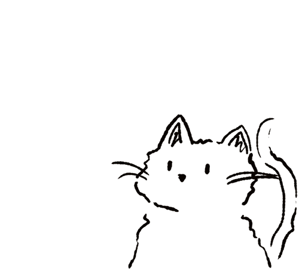

<h1 align="center">Iulian</h1>

  <strong>Software developer and game maker from Romania</strong>

  
   
  <em>My toughest code reviewer.</em>

  
  

---

## About me

Hey, I’m Iulian. I make games, write tools for tasks I’d rather automate, and like figuring out what makes things tick. A lot of my projects start with a small question, like whether a game mechanic would feel better with different timing.

I like getting a first version working, then coming back to see what I can simplify. Lately I’ve been getting more comfortable with lower-level programming and exploring how software behaves when performance matters. I’m also curious about cybersecurity.

## Languages

  <picture>
    <source media="(prefers-color-scheme: dark)" srcset="https://skillicons.dev/icons?i=python%2Ccpp%2Clua%2Crust&amp;theme=dark">
    
  </picture>

## GitHub activity

  <a href="https://github.com/iulian224">
    <picture>
      <source media="(prefers-color-scheme: dark)" srcset="https://github-readme-activity-graph.vercel.app/graph?username=iulian224&amp;theme=github-compact&amp;bg_color=0D1117&amp;line=E78EAA&amp;point=6EA6FF&amp;hide_border=true">
      
    </picture>
  </a>

  <picture>
    <source media="(prefers-color-scheme: dark)" srcset="https://github-readme-stats.vercel.app/api?username=iulian224&amp;show_icons=true&amp;theme=github_dark&amp;title_color=F3B2C8&amp;icon_color=6EA6FF">
    
  </picture>
  <picture>
    <source media="(prefers-color-scheme: dark)" srcset="https://github-readme-stats.vercel.app/api/top-langs/?username=iulian224&amp;layout=compact&amp;theme=github_dark&amp;title_color=F3B2C8">
    
  </picture>

## Beyond code

Away from the editor, I’m usually playing competitive FPS games, comparing PC parts, or reading manga. Gaming got me curious about what actually affects how a setup feels, from mouse sensors and refresh rates to input latency. I also enjoy building PCs and seeing how far a good configuration can take them.

<strong>Peripherals I use</strong>

- **Keyboard** — NuPhy Halo65HE
- **Mice** — Hator Pulsar 3 Ultra, modded Endgame Gear OP1 8K, and Lamzu Fnatic Maya X

